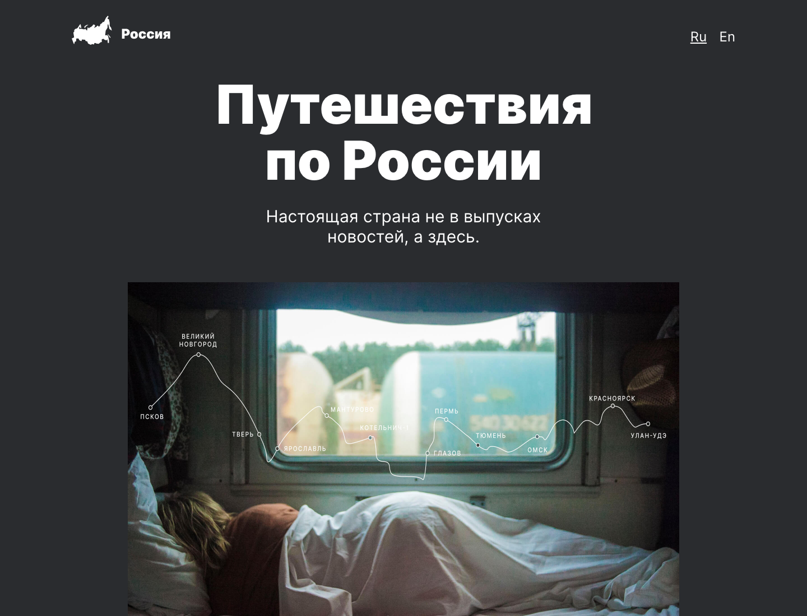
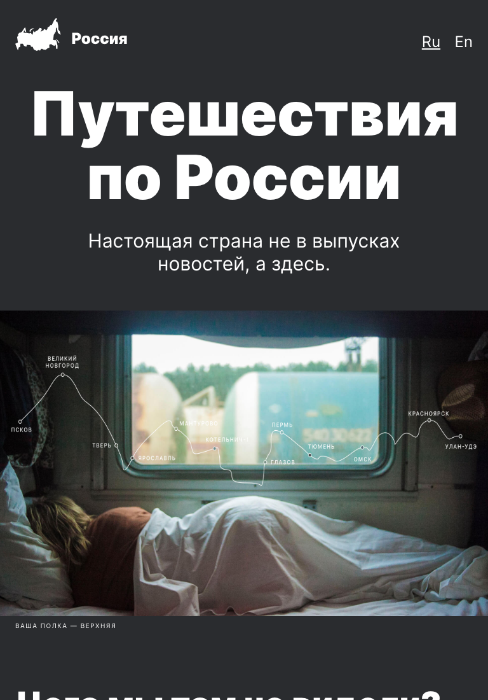

# Путешествия по России

Одностраничный сайт о путешествиях по России: фотографии, интересные факты и маршруты от Куршской косы до Байкала. Учебный проект адаптивной вёрстки на HTML и CSS.

[Открыть сайт](https://simfart.github.io/russian-travel/) · [Макет в Figma](https://www.figma.com/file/5S2WSbEFL6awjVWJ0NWL8Q/Sprint-3_-Russia-_-desktop-%2B-mobile?node-id=63326%3A0)

## О проекте

На странице собраны фотогалерея и рассказы о Куршской косе, Кольском полуострове, Алтае, зимнем Байкале и Карелии. Ссылки в карточках помогают узнать больше о каждом направлении.

## Технологии

- HTML5 и CSS3, без JavaScript и фреймворков.
- Организация стилей по БЭМ: отдельные файлы для блоков, элементов и модификаторов.
- Flexbox и Grid Layout для расположения элементов и фотогалереи.
- Медиазапросы и `calc()` для адаптивных размеров и типографики.
- Локальные шрифты Inter в форматах WOFF и WOFF2.

## Скриншоты

Снимки сделаны в Chrome с локального сайта по адресу `http://127.0.0.1:8000/`. Показана верхняя часть страницы.

### Десктоп — 1440 × 1100



### Планшет — 768 × 1100



## Локальный запуск

Понадобятся Git и Python 3. Устанавливать зависимости и собирать проект не требуется.

```bash
git clone https://github.com/simfart/russian-travel.git
cd russian-travel
python3 -m http.server 8000 --bind 127.0.0.1
```

Откройте [http://127.0.0.1:8000](http://127.0.0.1:8000) в браузере. Если проект уже скачан, запустите последнюю команду из его корневой папки. Чтобы остановить сервер, нажмите `Ctrl+C` в терминале.

## Структура проекта

```text
index.html        — разметка страницы
styles/index.css  — подключение стилей
blocks/           — стили компонентов по БЭМ
images/           — фотографии и логотип
vendor/           — normalize.css и локальные шрифты
docs/screenshots/ — скриншоты для README
```
